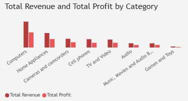
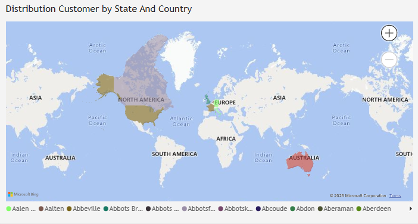
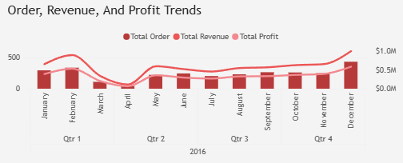
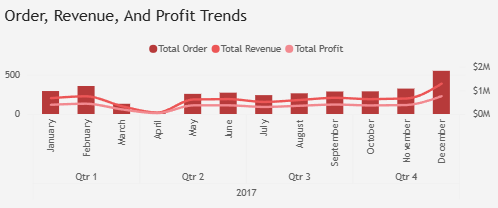
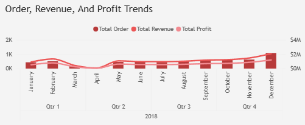
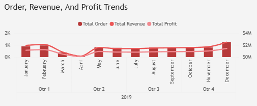
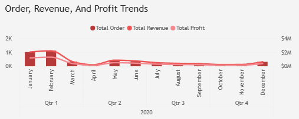
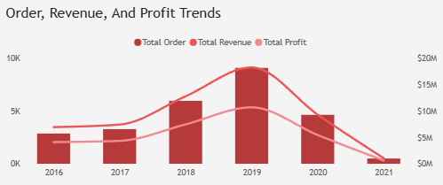
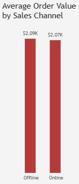

# Maven Global Electronics Retailer Using Power BI
A Data Analytics portfolio project using Microsoft Power BI to analyze global electronics sales performance, customer distribution, sales trends, delivery performance, and AOV comparisons between online and offline channels through interactive dashboards and data visualizations.
## Introduction
Global Electronics Retailer is a data analytics project focused on evaluating retail business performance. The analysis provides insights into product category sales, customer distribution across different countries, changes in sales performance over time, delivery performance, and differences in transaction values between online and offline sales channels.

The dataset used in this project is provided by [Maven Analytics](https://app.mavenanalytics.io/datasets?search=Global+Electronics+Retailer).
## Project Goals
This project aims to answer the following business questions :
1. What types of products does the company sell, and where are customers located?
2. Are there any seasonal patterns or trends for order volume or revenue?
3. How long is the average delivery time in days? Has that changed over time?
4. Is there a difference in average order value (AOV) for online vs. in-store sales?

## Analysis Result
### Product Categories & Customer Distribution
Based on the product categories, there are 10 types of products analyzed, including Computers, Home Appliances, Cameras and Camcorders, Cell Phones, TV and Video, Audio, Music, Movies and Audio Books, and Games and Toys. Among these categories, Computers generate the highest revenue and profit, while Games and Toys generate the lowest revenue and profit.

Furthermore, based on the Customer Distribution Map, customers are distributed across eight countries: Australia, Canada, France, Germany, Italy, the Netherlands, the United Kingdom, and the United States.

The number of customers in each country is as follows :

|     Country    | Number of CUstomers |
|:--------------:|:-------------------:|
|    Australia   |        1,420        |
|     Canada     |        1,553        |
|     France     |         670         |
|     Germany    |        1,473        |
|      Italy     |         645         |
|   Netherlands  |         733         |
| United Kingdom |        1,944        |
|  United States |        6,828        |

Based on these figures, the United States has the highest number of customers, while Italy has the lowest.

### Sales Seasonality & Trends (2016–2020)
#### Sales History Analysis (2016–2020)
During the 2016–2020 period, sales performance was examined to identify potential seasonal trends. The analysis focused on three key metrics : the number of orders, revenue, and profit. Seasonal patterns were identified by visualizing monthly sales performance for each year. These visualizations aim to observe changes in sales performance, including upward and downward movements throughout the observation period.

The monthly Sales History Line visualizations for each year are presented in Figures 1 through 5.

Based on the Sales History Line visualizations in Figures 1 through 5, potential seasonal patterns can be observed in sales performance throughout the 2016–2020 period. From 2016 to 2019, sales performance generally declined between February and April, followed by an upward trend from May through December. This pattern is reflected in the movements of orders, revenue, and profit. Meanwhile, 2020 shows a potential change in the trend, particularly as sales performance tends to decline from May through December. To quantify these changes, further analysis was conducted using growth rates and comparisons of actual values across the months that exhibited these patterns.

##### February-April Sales Decline
Based on the declining pattern observed in the monthly visualizations, the subsequent analysis focuses on the February-April period. To measure the extent of changes in sales performance during this period, growth rates were calculated for February to March and March to April, as presented in Table 1.

Table 1. Growth Rate February-March and March-April
|      | Growth Feb-Mar Order | Growth Mar-Apr Order | Growth Feb-Mar Revenue | Growth Mar-Apr Revenue | Growth Feb-Mar Profit | Growth Mar-Apr Profit |
|:----:|:--------------------:|:--------------------:|:----------------------:|:----------------------:|:---------------------:|:---------------------:|
| 2016 |        -68.68%        |        -59.41%       |         -63.43%        |         -63.70%        |        -63.19%        |        -65.99%        |
| 2017 |        -64.96%       |        -75.59%       |         -57.31%        |         -80.80%        |        -56.75%        |         -80.44%        |
| 2018 |        -64.85%       |        -75.29%       |         -69.28%         |         -82.18%        |        -69.09%        |         -80.79%        |
| 2019 |        -63.24%       |        -79.17%       |         -62.45%        |         -80.91%        |        -62.50%        |        -80.79%        |
| 2020 |        -71.91%       |        -75.61%       |         -70.97%        |         -67.56%         |        -71.05%        |        -67.47%        |

Based on Table 1, all three metrics recorded negative growth in every year of the observation period. From February to March, orders declined by approximately 63-72%, revenue by 57-71%, and profit by 57-71%. The declines continued from March to April, with orders decreasing by approximately 59-79%, revenue by 64–82%, and profit by 65-81%. Although the magnitude of the declines varied across years, the consistent negative growth across both periods indicates a weakening trend in sales performance through April.

To provide a clearer picture of this declining pattern, Table 2 presents the actual values of orders, revenue, and profit for February, March, and April throughout the observation period. These actual values illustrate how the percentage changes in growth were reflected in sales performance in each year.

Table 2. Actual Orders, Revenue, and Profit (February-April)
|      | Feb Order | Mar Order | Apr Order | Feb Revenue | Mar Revenue | Apr Revenue | Feb Profit | Mar Profit | Apr Profit |
|:----:|:---------:|:---------:|:---------:|:-----------:|:-----------:|:-----------:|:----------:|:----------:|:----------:|
| 2016 |    334    |    109    |     41    |   $891.10K  |   $338.41K  |   $110.59K  |  $531.72K  |  $203.51K  |   $66.23K  |
| 2017 |    356    |    130    |     26    |   $750.53K  |   $331.25K  |   $58.58K   |  $435.74K  |  $194.76K  |   $35.06K  |
| 2018 |    513    |    193    |     26    |    $1.34M   |   $434.95K  |   $70.63K   |  $792.34K  |  $257.88K  |   $40.83K  |
| 2019 |    967    |    386    |     75    |    $2.10M   |   $845.93   |   $149.89   |    $1.2M   |  $496.10K  |   $88.47K  |
| 2020 |     1K    |    332    |     80    |    $2.23M   |   $645.99K  |   $217.64K  |   $1.31M   |  $396.20K  |  $128.03K  |

Based on Table 2, the decline in sales performance is also evident in the actual values of all three metrics. For example, in 2019, the number of orders decreased from 967 in February to 386 in March, before dropping further to 75 in April. Similarly, revenue declined from $2.10M to $845.93K and subsequently to $149.89K. Profit also decreased from $1.20M in February to $496.10K in March, reaching $88.47K in April. These results reinforce the declining pattern identified in Table 1, as demonstrated by both the growth rates and the actual values of each metric.

##### May-December Sales Growth
In addition to the decline observed between February and April, the visualizations in Figures 1 through 5 also indicate an upward trend in sales performance following this period. From 2016 to 2019, improvements generally began in May and continued through December. To quantify this increase, orders, revenue, and profit were compared between May and December, as presented in Tables 3 and 4.

Table 3
|      | May Order | Dec Order | May Revenue | Dec Revenue | May Profit | Dec Profit |
|:----:|:---------:|:---------:|:-----------:|:-----------:|:----------:|:----------:|
| 2016 |    220    |    429    |   $595.99K  |   $998.40K  |  $356.05K  |  $584.55K  |
| 2017 |    256    |    549    |   $616.26K  |    1.29M    |  $366.24K  |  $755.67K  |
| 2018 |    464    |     1K    |    $1.07M   |    $2.08M   |  $626.11K  |   $1.20M   |
| 2019 |    808    |     1K    |    $1.59M   |    $2.48M   |  $933.50K  |   $1.44M   |
| 2020 |    455    |    318    |   $878.03K  |   $651.53K  |  $514.05K  |  $384.66K  |

Table 4
|      | Growth May-Dec Order | Growth May-Dec Revenue | Growth May-Dec Profit |
|:----:|:--------------------:|:----------------------:|:---------------------:|
| 2016 |          95%         |         67.52%         |         64.18%        |
| 2017 |        114.45%       |         109.33%        |        106.33%        |
| 2018 |        115.52%       |         94.39%         |         91.66%        |
| 2019 |        23.76%        |         55.97%         |         54.26%        |
| 2020 |        -30.11%       |         -25.80%        |        -25.17%        |

Based on Tables 3 and 4, the 2016-2019 period generally showed an increase in sales performance from May through December. The highest growth in orders occurred in 2017 and 2018, reaching 114.45% and 115.52%, respectively. In 2017, revenue and profit also increased by 109.33% and 106.33%, respectively. These findings indicate that May through December generally represented a period of sales growth during 2016-2019. However, a different pattern emerged in 2020, when sales performance declined from May to December. This was reflected in a 30.11% decrease in orders, a 25.80% decrease in revenue, and a 25.17% decrease in profit.

##### Overall Monthly Seasonal Pattern
When viewed across the entire annual cycle, monthly sales performance from 2016 to 2019 exhibited a relatively recurring seasonal pattern. Sales performance generally reached its highest level in December, followed by a slight decline in January and a modest recovery in February before entering another period of significant decline from March through April. Sales performance then generally increased again from May through December. These movements indicate a potential seasonal pattern characterized by a decline in the early months of the year, followed by an upward trend toward year-end. However, this pattern was not fully observed in 2020, as sales performance declined from May through December. This suggests a change in the sales trend in 2020 compared with previous years.

##### Annual Sales Trends (2016-2020)
After identifying potential seasonal patterns through monthly performance movements, the analysis was extended to annual sales performance. This analysis aims to examine changes in orders, revenue, and profit from year to year throughout the 2016-2020 period. To illustrate these trends, an annual Sales History Line visualization was created, as presented in Figure 6.

Based on the annual Sales History Line visualization in Figure 6, a change in the overall sales performance trend can be observed. In general, sales performance showed an upward trend from 2016 to 2019, followed by a decline in 2020. To quantify these changes across the three metrics, annual growth rates and actual sales values were compared, as presented in Table 5.

Table 5.
|      | Order | Growth Order | Revenue | Growth Revenue |  Profit | Growth Profit |
|:----:|:-----:|:------------:|:-------:|:--------------:|:-------:|:-------------:|
| 2016 |  2.8K |       -      |  $6.95M |        -       |  $4.11M |       -       |
| 2017 |  3.2K |    15.05%    |  $7.42M |      7.41%     |  $4.34M |     6.22%     |
| 2018 |   6K  |    81.86%    | $12.79M |     72.32%     |  $7.46M |     72.12%    |
| 2019 |   9K  |    52.27%    | $18.26M |     42.18%     | $10.70M |     43.31%    |
| 2020 |   5K  |    -49.17%   |  $9.29M |     -49.30%    |  $5.45M |    -49.27%    |

Based on Table 5, annual sales performance generally increased from 2016, reaching its highest level in 2019. The most significant growth occurred in 2018, when orders increased by 81.86%, revenue by 72.32%, and profit by 72.12% compared with the previous year. This upward trend continued in 2019, with orders reaching approximately 9K, revenue amounting to $18.26M, and profit reaching $10.70M. These findings indicate positive annual sales performance throughout the 2016-2019 period.

However, this upward trend did not continue in 2020. Compared with the previous year, orders declined by 49.17%, revenue by 49.30%, and profit by 49.27%. Nevertheless, sales performance in 2020 remained above the levels recorded in 2016 and 2017. This is reflected in approximately 5K orders, $9.29M in revenue, and $5.45M in profit. Therefore, the decline in 2020 indicates a change in annual sales performance, consistent with the deviation from the previous upward monthly trend observed between May and December.

### Average Delivery Time Performance (2016-2021)
The overall average delivery time is 4 days.

Based on the data, the average delivery time is 4 days. Delivery times have changed over the years. In 2016, the average delivery time was 7 days, which decreased to 5 days in 2017. From 2018 to the January–February period of 2021, the average delivery time remained stable at 4 days. This indicates that delivery times have become faster compared to previous years and have remained relatively consistent since 2018.

| Year | Data Period | Average |
|:----:|:-----------:|:-------:|
| 2016 |   Jan-Dec   |  7 Days |
| 2017 |   Jan-Dec   |  5 Days |
| 2018 |   Jan-Dec   |  4 Days |
| 2019 |   Jan-Dec   |  4 Days |
| 2020 |   Jan-Dec   |  4 Days |
| 2021 |   Jan-Feb   |  4 Days |

### Online vs. In-Store Average Order Value (AOV)
| Year | Data Period | Online | Offline |
|:----:|:-----------:|:------:|:-------:|
| 2016 |   Jan-Dec   | $2.46K |  $2.42K |
| 2017 |   Jan-Dec   | $2.29K |  $2.16K |
| 2018 |   Jan-Dec   | $2.16K |  $2.07K |
| 2019 |   Jan-Dec   | $2.03K |  $1.95K |
| 2020 |   Jan-Dec   | $2.03K |  $1.93K |
| 2021 |   Jan-Feb   | $2.09K |  $2.07K |

Based on the data, there is a difference in the Average Order Value (AOV) between online and offline (in-store) sales. Overall, the AOV of online sales tends to be higher than that of offline sales across all periods. In 2016, the online AOV was $2.46K, while the offline AOV was $2.42K. Both sales channels then experienced a gradual decline until 2020, with the online AOV reaching $2.03K and the offline AOV reaching $1.93K. In the January-February 2021 period, both experienced a slight increase, reaching $2.09K for online sales and $2.07K for offline sales. Therefore, it can be concluded that the AOV of online sales is consistently higher than that of offline (in-store) sales, although the difference between the two is relatively small.

## Project Information
1. Tools           : Microsoft Power BI
2. Data Prepation  : Power Query
3. Calculations    : DAX
4. Analysis Focus  : Product Categories, Customers Distribution, Sales Seasonality & Trends, Delivery Performance, and Online vs. In-Store Average Order Value (AOV)

   
